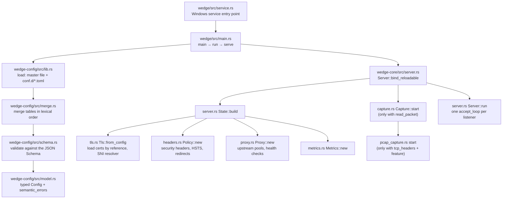
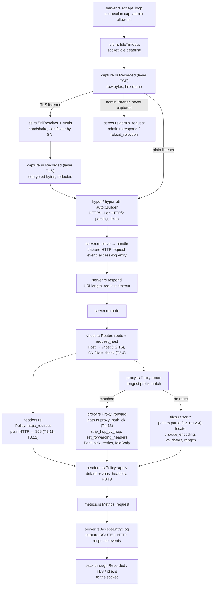
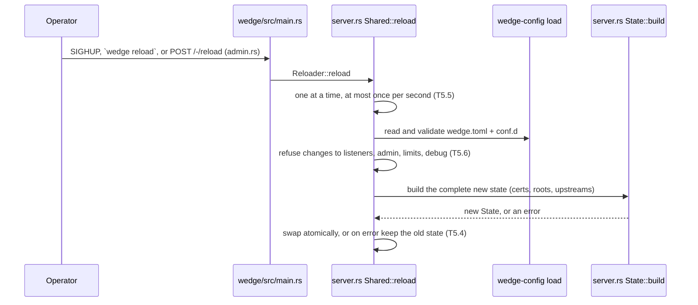

# Request flow

How a request travels through wedge's source files, from the process entry
point to the bytes going back to the client. Use it with the debug capture
log (`[server.debug] read_packet = true`): every capture event names the
`file:line` that produced it, and those files are the boxes below.

Paths are relative to `crates/`. `wedge-core/src/server.rs` is the hub; the
other modules each own one step.

## Startup

## One request

## Reload

## Reading the capture log against this map

| Capture event (layer, source) | Box above | What it shows |
|---|---|---|
| `TCP server.rs` "accepted ..." | `accept_loop` | client and local address, listener kind |
| `TCP capture.rs` "<- / -> N bytes" | `Recorded (layer TCP)` | raw bytes; ciphertext on TLS listeners |
| `TLS server.rs` "handshake complete ..." | `SniResolver + rustls` | SNI, ALPN, TLS version, cipher suite |
| `TLS capture.rs` "<- / -> N bytes" | `Recorded (layer TLS)` | decrypted bytes, credentials redacted |
| `HTTP server.rs` "request ..." | `serve → handle` | parsed request line and headers |
| `ROUTE files.rs` "static file ..." | `files.rs serve` | the file that was served |
| `ROUTE proxy.rs` "proxy upstream=..." | `Proxy::forward` | upstream and server that answered |
| `ROUTE server.rs` "answered by wedge" | `route` / `respond` | an error, redirect or limit response |
| `HTTP server.rs` "response ..." | `AccessEntry::log` | status, headers, time to response head |
| `IP pcap_capture.rs` "a > b flags [...]" | below `accept_loop` | IP/TCP headers: seq, ack, flags, window, retransmissions |

Connection ids (`conn=N`) tie the events of one connection together. IP/TCP
header events have `conn=0`; match them to a connection by the client port in
the `TCP ... accepted` event.
